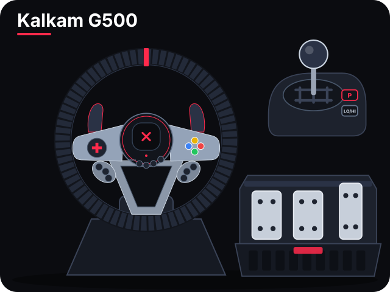
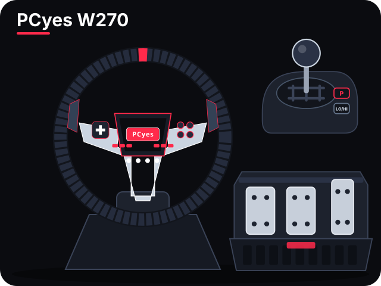

# G500 Config

Programa para configurar os volantes **Kalkam G500** e **PCyes W270** no Windows (os dois usam o mesmo protocolo da LITE STAR). A interface segue o layout `kalkam_g500_pcyes_w270_configurator.html`, no estilo do Logitech G HUB, e roda numa janela do Windows (WebView2, já incluso no Windows 10/11).

<p align="center">
  
  
</p>

**Baixar:** o `G500Config.exe` pronto fica na aba [Releases](../../releases). É um arquivo só; não precisa instalar Python.

## Como abrir
- **Em qualquer PC:** baixe o `G500Config.exe` na aba Releases (ou gere em `dist\`) e dê dois cliques. Não precisa instalar Python nem nada.
- **Neste PC, a partir do código:** dê dois cliques em **Abrir G500 Config.bat**.

## Levando para outro PC
1. Copie só o arquivo `G500Config.exe`.
2. Para levar seus perfis: na página **Perfis**, clique em **Exportar todos…** e copie o `.json` junto. No outro PC, use **Importar perfis…**.
3. Para usar o modo compatibilidade (controle de Xbox virtual), o outro PC precisa do driver ViGEmBus. O instalador já vem dentro do programa: na página **Compatibilidade**, clique em **Instalar driver do controle virtual**.
4. O Bluetooth do outro PC precisa estar ligado para usar a página **Volante (Bluetooth)**.

## Abas
- **Topo**: conexão USB e Bluetooth, escolha do volante (Kalkam G500 / PCyes W270; em **Auto**, o programa escolhe pelo volante conectado), **Foto/Desenho** (como os volantes aparecem no seletor) e **Cor** da interface (vermelho por padrão; vale para a janela inteira e o logotipo).
- **Faixa de perfil**: perfil ativo, novo/duplicar/renomear/excluir, importar/exportar e a chave **Sentir os ajustes**.
- **Volante e Força**: aro girando em tempo real, trava de ângulo (270°/540°/720°/900° + ajuste fino), força, mola, amortecimento, atrito e inércia gravados no volante (**Enviar ao volante**, com confirmação), e a resposta da direção no programa.
- **Pedais e Câmbio**: pedais ao vivo, zona morta/saturação/curva de cada pedal (**Enviar curvas ao volante**), câmbio H já configurado (marchas 1–6 = botões 16–21, ré = 22, freio de mão (P) = 15, LO/HI = 23; clique e engate para corrigir), eixos e calibração.
- **Botões**: desenho do volante conforme o manual, com etiquetas laterais ligadas a cada botão (estilo G HUB); o número é o botão físico e acende ao apertar. Padrão do manual (contado a partir de 0): A 0, B 1, X 2, Y 3, L1/L-Paddle 4, R1/R-Paddle 5, L2 6, R2 7, SHARE 8, OPTIONS 9, L3 10, R3 11, MODE 12, Captura 13. **Detectar** corrige um botão; também se escolhe o botão de Xbox do modo compatibilidade. **Resetar mapeamento** volta botões, câmbio e Xbox ao padrão.
- **Force feedback**: força gerada pelo próprio programa e botões de teste.
- **Compatibilidade**: controle de Xbox virtual, drivers ViGEmBus/HidHide, modo USB (DInput/XInput) e padrão de fábrica.
- **Overlay nos jogos**: barras de embreagem, freio e acelerador por cima do jogo (veja abaixo).
- **Perfis**: lista de perfis (clique para ativar, lápis renomeia, lixeira exclui; o "Padrão" é fixo), novo/duplicar, importar/exportar, jogos (.exe) que ativam cada um e troca automática.

**Sentir os ajustes**: os ajustes gravados no volante (força, mola, amortecimento, atrito, inércia e ângulo) modificam as forças que o jogo manda; fora de um jogo o volante fica solto. Com a chave ligada, enquanto a janela do programa estiver em primeiro plano, ele manda forças de referência como um jogo, para você sentir o efeito. Ao trocar de janela ou abrir um jogo cadastrado, ele solta o volante.

Todo envio ao volante é confirmado: o programa relê o volante e compara com o que foi enviado. Ao lado do botão aparece um ícone girando com o tempo em segundos, depois ✔ (confirmado) ou ✖ (não confirmado). O ! laranja indica que algo foi alterado e ainda não foi enviado.

A barra de título do Windows usa as cores do programa (Windows 11). No rodapé, **− / + / Auto** muda a proporção da interface (também Ctrl + roda do mouse, Ctrl +, Ctrl -, Ctrl 0); em Auto ela se ajusta ao tamanho da tela.

## Overlay nos jogos
1. Na aba **Overlay nos jogos**, ligue a chave do topo do cartão.
2. Ligue **Posicionar com o mouse** e arraste as barras na tela (ou use os cantos prontos e os controles X/Y).
3. Ajuste opacidade, tamanho, orientação (em pé/deitadas), letras, porcentagem e quais pedais aparecem.
4. Desligue **Posicionar com o mouse**: a partir daí os cliques passam através das barras para o jogo.

Funciona em jogos em janela ou "tela cheia sem bordas" (borderless). Em tela cheia exclusiva o Windows não deixa nada aparecer por cima: nesse caso mude o jogo para "sem bordas".

## Modo compatibilidade: passo a passo
1. Ative o perfil do jogo, ou marque *Modo compatibilidade* no perfil atual.
2. Recomendado: instale o **HidHide**, oculte o *KalkanG500* nele e libere o `G500Config.exe` (ou o `pythonw.exe` da pasta `.venv\Scripts`, se usar pelo código). Assim o jogo vê só o controle virtual.
3. No jogo, escolha o controle (gamepad), não o volante. Deixe a zona morta e a assistência de direção no mínimo.

## Gerar o .exe de novo (depois de mudar o código)
```
python -m venv .venv
.venv\Scripts\pip install -r requirements-build.txt
.venv\Scripts\python ferramentas\gerar_icone.py      (só se quiser refazer o ícone)
node ferramentas\gerar_desenhos.js                  (só se quiser refazer os desenhos de docs/)
.venv\Scripts\pyinstaller G500Config.spec --noconfirm
```
O resultado sai em `dist\G500Config.exe`. Para conferir se está tudo funcionando: `G500Config.exe --autoteste resultado.json`. A interface antiga (tkinter) continua disponível com `G500Config.exe --classico`, e é usada sozinha se o PC não tiver o WebView2.

## Protocolo Bluetooth (tirado do app "Racing Wheel", com.star.v10 1.0.26)
Nome do aparelho: `FFB WHEEL KalkanG500`. O PC escreve em FFE1 e recebe as respostas em FFE2 (serviço FFE0). Detalhes dos comandos em `g500/ble.py`. Pelo cabo USB o volante não aceita esses comandos (testado).

## Observações
- Zona morta, curvas e ângulo desejado só valem no modo compatibilidade. Fora dele, o jogo lê o volante direto.
- Com "Programa controla o force feedback" ligado, o jogo não consegue mandar força ao volante.
- Os perfis ficam em `%APPDATA%\G500Config` (em cada PC).
- Alguns antivírus desconfiam de programas feitos com PyInstaller que não têm assinatura digital. Se isso acontecer, libere o `G500Config.exe` no antivírus.

## Licença
Código sob a licença **MIT** (veja `LICENSE`). Fotos dos produtos, marcas, fontes, ícones e bibliotecas de terceiros seguem as licenças dos seus donos: veja `AVISOS-DE-TERCEIROS.md`. Projeto independente, sem ligação com Kalkan/Kalkam, PCyes, LITE STAR ou Logitech.
